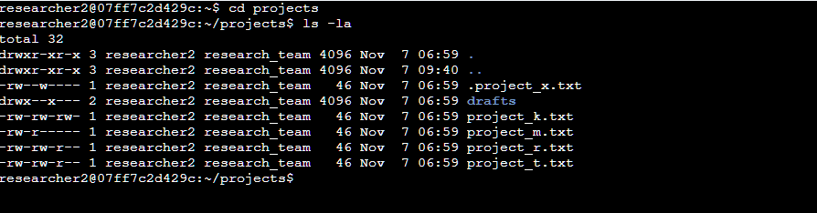
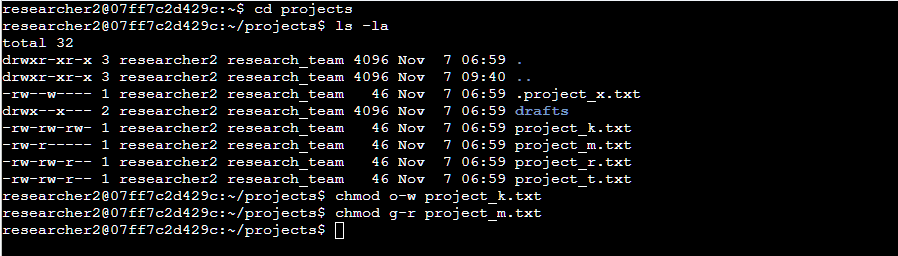
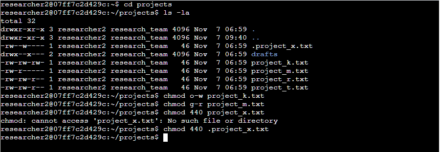
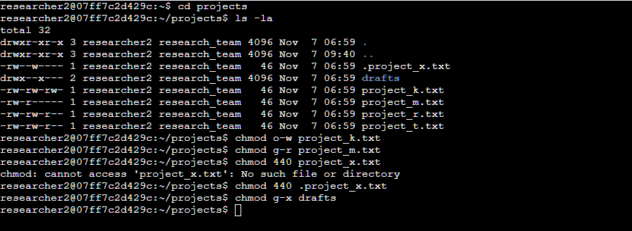

# **[File permissions in Linux]{.underline}**

## 

## **Project description**

The objective of this portfolio piece is to demonstrate how to use Linux
commands to:

- Show file and directory permissions, including those of hidden files

- Navigate between directories

- Change file and directory permissions

The piece is broken into steps using screenshots, and I have provided
explanations of how key concepts and features work to demonstrate my
understanding.

## **The permissions string**

In this activity, two types of permission string are shown in the
console: directory permission strings and file permission strings. Using
examples from the activity I will explain how these show permissions:

> *drwx\--x\-\-- 2 researcher2 research_team 4096 Nov 7 06:59 drafts*
>
> *-rw-rw-rw- 1 researcher2 research_team 46 Nov 7 06:59 project_k.txt*

- **The first character** in the sequence signifies whether the
  permissions relate to a directory or file, with d being used for
  directory and - used for a file.

- **The number:** after the permissions string the top example has the
  number 2 and the bottom the number 1. This refers to the number of
  hard links, which shows how many names point to the same piece of
  data. For drafts, a directory, this is 2 as one name for the directory
  is /home/researcher2/projects/drafts and the character . can also be
  used to refer to that same directory from within it. project_k.txt by
  comparison has only one hard link, meaning project_k.txt is the only
  name used in the entire system referring to that file.

- **The following string** comprises the characters r, w, x and -.
  Permissions are always shown in order of user/group/other. The user is
  the owner of the file, and will often have the highest level of
  access. The group often comprises those who work with the files and
  directories, and typically has a high level of access but fewer than
  the user. Other refers to those who are neither the owner or group
  members and typically has the lowest level of access,

- **r = read**. With files this allows a user to view contents, and with
  a directory this allows the user to list the names inside the
  directory (both files and other directories).

- **w = write**. With files this allows a user to modify contents, with
  a directory this allows the user to add, delete and rename entries
  (files and directories)

- **x = execute**. With files this allows a user to run a script or
  programme, with a directory this is the first level of access required
  to allow a user to access a directory: without x write access cannot
  be used and read access is of limited use.

- Using the first example from above, the drafts directory permissions
  rwx allow the user to read, write and execute; the group permissions
  \--x allow it to execute only; and other has \-\-- which grants it no
  permissions.

- researcher2 is the name of the user to whom user permissions apply,
  and research_team is the group to whom group permissions apply.

- 4096 for the directory refers to the size in bytes of the directory
  entry (excluding the size of its file contents) and for a 46 for the
  file refers to its size in bytes.

- Nov 7 06:59 refers to the date and time the directory or file was last
  modified.

- drafts refers to the directory name, and project_k.txt refers to the
  file name.

**Task 1: check file and directory permissions**

{width="6.5in"
height="1.6944444444444444in"}

The current working directory at the beginning of the activity was
/home/researcher2, however to begin the activity I needed to navigate to
the folder projects contained within the working directory. I did this
using the cd (change directory) command, and as the projects folder was
contained in my current working directory I simply followed the command
with the folder name.

My next step was to understand which directories and files were
contained within the projects directory, and to check assigned
permissions. To do this I used the list command, ls, with the flags -l
(long list format flag which shows the metadata for each file and
directory) and -a (all flag which ensures all directories and files are
shown, including hidden ones). In the above screenshot .. represents the
parent directory, and . represents the current working directory
(projects).

**Task 2: change file permissions**

{width="6.5in"
height="1.8472222222222223in"}

As part of this activity, other should have no write permissions. As
shown in the screenshot, the permissions on project_k were set to allow
writing.

To amend this I used the chmod (change mode) command to alter
permissions. I did this symbolically, using "o-w project_k.txt". O
refers to other, - removes a permission, and w is short for write and
project_k.txt specifies which file permissions are being altered for. In
doing this, write permissions were removed from this file.

project_m.txt is another restricted file and only the user should be
able to read or write to it. As shown above, the group has read
permissions which need to be removed. To do this the same chmod command
was used again symbolically, with g-r indicating that read permissions
were removed from the group.

**Task 3: Change file permissions on a hidden file**

.project_x.txt is a hidden file, as indicated by the . before its name,
and nobody should have permission to write to it. The screenshot
indicates that both the user and group have this permission.

{width="6.5in" height="2.25in"}

As shown in the screenshot, I made the error of using chmod on
project_x.txt and omitted the . before the name, and "No such file or
directory" was returned as a result.

The second, correct, command used the chmod numerically. Each of the
three numbers comprising 440 modify the permissions of the
user/group/other, respectively. The highest level of permissions for
each is 7 (4+2+1), this is broken down as follows:

- 4: Read contents for a file / See names inside for a directory

- 2: Change contents of a file / Add, delete or rename contents for a
  directory

- 1: Execute by running the file as a programme or script / Enter a
  directory and open contents

The sum of these numbers in different combinations always makes clear
which of the permissions (read/write/execute) are being set, and in this
case by setting 440 we are setting user=read, group=read and other=no
capability to read/write/execute.

**4 Change directory permissions**

The screenshot below shows that the directory drafts currently has its
permissions set to allow read/write/execute to the user; execute to the
group, and other has no permissions.

Only the user should be able to access the drafts directory, this is set
by the execute (x) permission.

{width="6.5in" height="2.375in"}

In this screenshot I used the symbolic command chmod g-x drafts. As the
directory has no file extension it is simply referred to as drafts, and
g-x means that execute permissions are taken, using -, from the group.
As above, the group in this example is named research_team.
